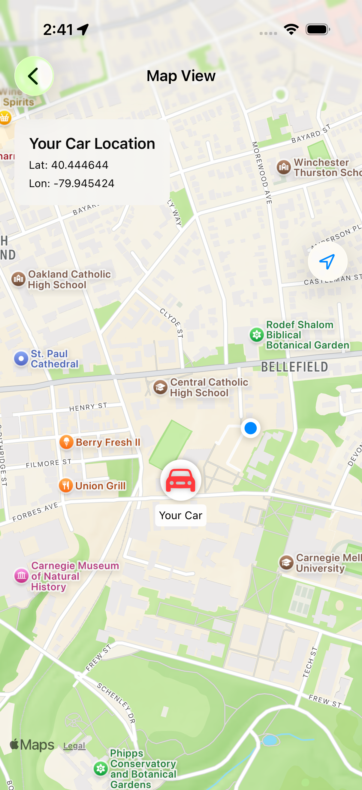

# Lab 8: FindMyCar

**Platform: Swift / SwiftUI**  
**Andrew ID: akkubais**  
**Branch: hw_lab8_Findmycar**

An iOS app that saves a parked car's location in an XML plist and displays the car and current user location with MapKit.

## Run

Open `FindMyCar.xcodeproj`, choose the **FindMyCar** scheme and an iPhone simulator, and run. Requires iOS 17 or newer. Set a simulated location, then tap **Here's My Car** and allow location access. Tap **Where's My Car?** to see the map.

The lab's CMU test location is latitude `40.444644`, longitude `-79.945424`.

## Screenshots

These are unmodified captures from the running iPhone 17 Pro simulator. The location is simulated.

| Output | Screenshot |
| --- | --- |
| Initial screen | [01 — Home](Screenshots/01-home.png) |
| Save confirmation | [02 — Location saved](Screenshots/02-location-saved.png) |
| Saved state | [03 — Saved home](Screenshots/03-saved-home.png) |
| Parked car and current user | [04 — Map](Screenshots/04-car-map.png) |
| Restored after relaunch | [05 — Persistence](Screenshots/05-restored-after-relaunch.png) |
| Location permission denied | [06 — Error](Screenshots/06-location-error.png) |

## Validation

**11 tests passed, 0 failures, 0 skipped** on 31 October 2026 using Xcode 27.1 and the iOS 26.5 simulator.

- Nine model tests cover coordinates, plist round trips, clearing, restoration, denied permission, and corrupt saved data.
- Two UI tests cover parking, map navigation, relaunch persistence, and denied permission.
- [Test results](TestResults.txt) · [Structured results](TestResults.json)

Use the **FindMyCar** scheme for model tests. The **FindMyCarScreenshots** scheme also runs the UI tests; set a simulated location first. [Detailed instructions](README.txt).
